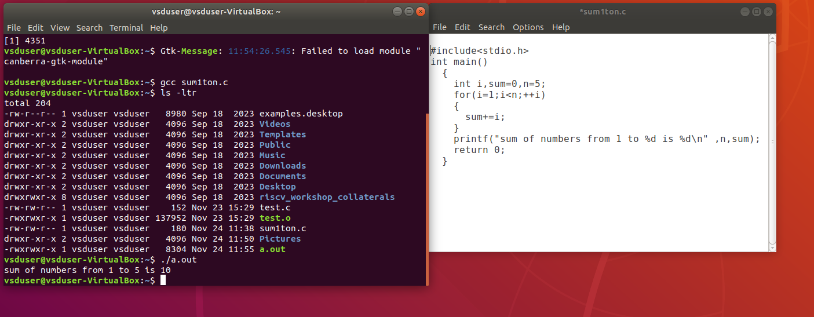
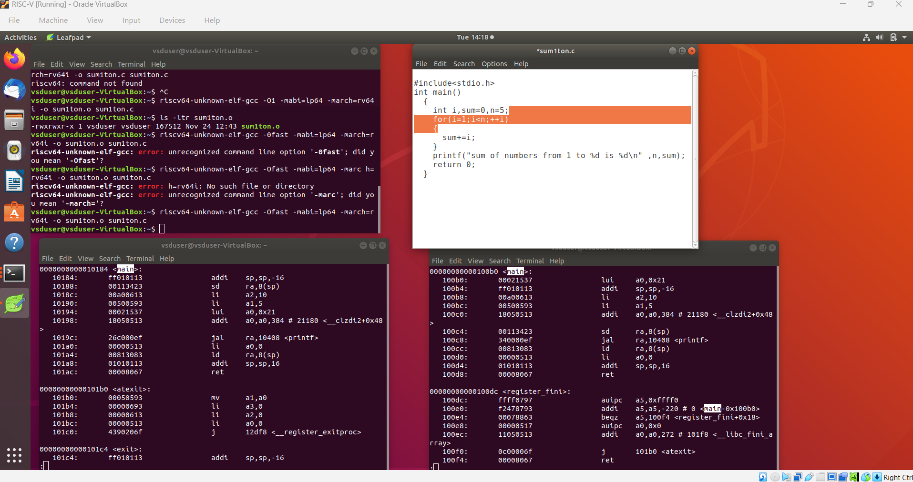
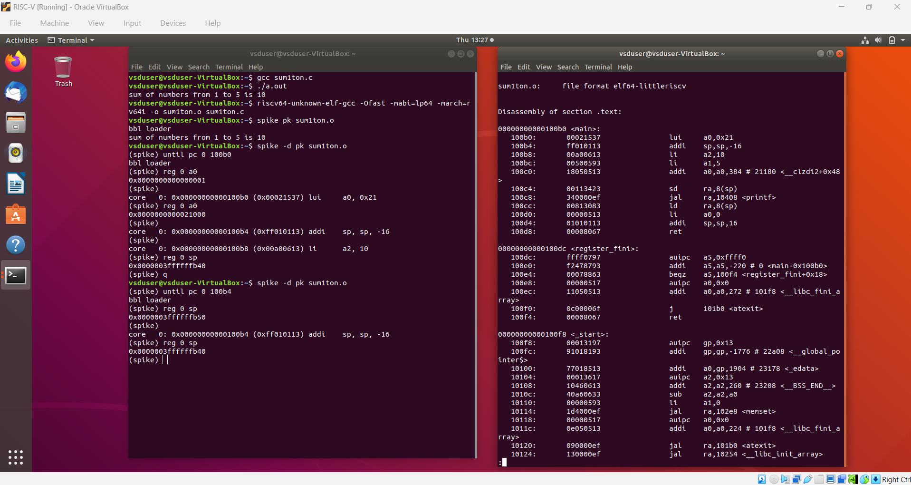
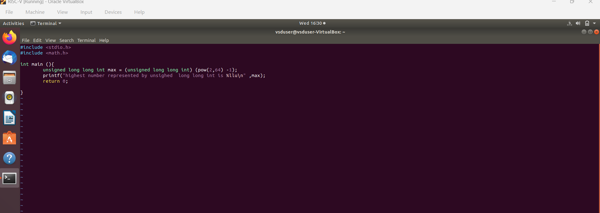
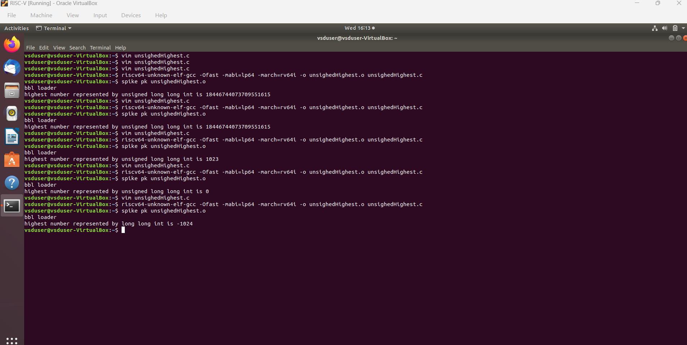
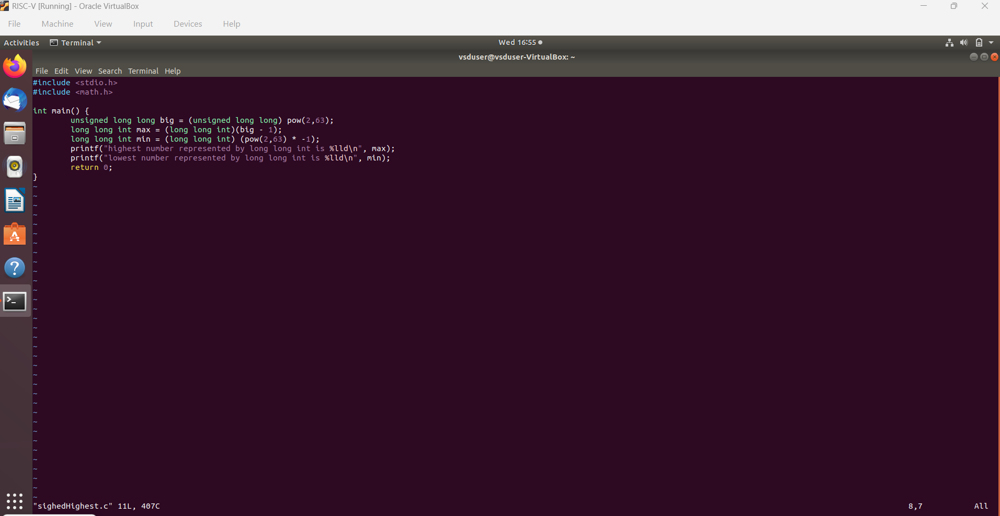
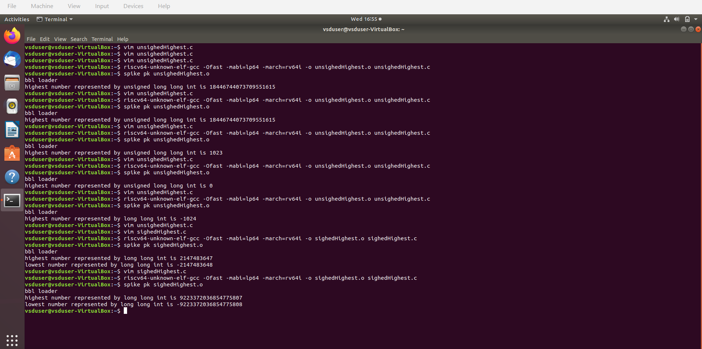

# Day 1 – RISC-V Architecture Basics

Lab work from Day 1 of the RISC-V workshop. Everything was done on an Ubuntu VM (Oracle VirtualBox) with the `riscv64-unknown-elf-gcc` toolchain, `objdump` and the `spike` simulator.

## 1. Introduction

- The **ISA (Instruction Set Architecture)** is the language of the computer, the way software talks to hardware.
- Applications run on hardware through **system software**, whose major components are:
  - **OS**: handles I/O, allocates memory, low-level system functions.
  - **Compiler**: converts high-level code (C, C++, Java) into assembly/instructions for the target hardware (Intel, ARM or RISC-V).
  - **Assembler**: converts assembly instructions into binary.
- If the hardware is RISC-V, the instructions are RISC-V instructions.
- **Extensions**: RV64I is the base integer ISA. Floating point is added by extensions such as `F` (single precision, RV64F) and `D` (double precision, RV64D). A CPU implementing all of them is RV64IMFD.
- **ABI (Application Binary Interface)**: the registers `a0, a1, sp, ra, ...` are accessed by programmers through ABI names. Data moves between registers and memory (memory allocation).

---

## 2. Lab 1 – Compile and run C natively

Program: `sum1ton.c` (sum of numbers from 1 to n, n = 5)

```c
#include<stdio.h>
int main()
{
    int i,sum=0,n=5;
    for(i=1;i<n;++i)
    {
        sum+=i;
    }
    printf("sum of numbers from 1 to %d is %d\n" ,n,sum);
    return 0;
}
```

```bash
gcc sum1ton.c
ls -ltr
./a.out
```



> **Note:** the loop condition in the screenshot is `i<n`, so it adds 1+2+3+4 = **10**. Use `i<=n` to get 15, the true sum from 1 to 5.

---

## 3. Lab 2 – RISC-V compile and assembly (objdump)

```bash
# -O1 build
riscv64-unknown-elf-gcc -O1 -mabi=lp64 -march=rv64i -o sum1ton.o sum1ton.c
ls -ltr sum1ton.o

# -Ofast build
riscv64-unknown-elf-gcc -Ofast -mabi=lp64 -march=rv64i -o sum1ton.o sum1ton.c

# Disassemble and search for main
riscv64-unknown-elf-objdump -d sum1ton.o | less
#   inside less: /main  then press n for the next match
```

- `-Ofast` is the correct flag (I mistyped it as `-0fast`, which gives "unrecognized command line option"), and `-march=rv64i` is the architecture flag (`-marc` is an error).
- `main` starts at `0x10184` in the `-O1` build and at `0x100b0` in the `-Ofast` build.



Observations from the disassembly (`-Ofast`):

```
100b0: lui   a0,0x21
100b4: addi  sp,sp,-16
100b8: li    a2,10          # sum already computed by the compiler
100bc: li    a1,5           # n
100c0: addi  a0,a0,384      # address of the format string
100c4: sd    ra,8(sp)
100c8: jal   ra,10408 <printf>
100cc: ld    ra,8(sp)
100d0: li    a0,0           # return 0
100d4: addi  sp,sp,16
100d8: ret
```

The compiler optimised the loop away and loaded the result `10` straight into `a2`.

### Running on spike

```bash
spike pk sum1ton.o              # run
spike -d pk sum1ton.o           # debug mode (terminal 1)
: until pc 0 100b0              # run until PC reaches main
: reg 0 a2                      # inspect register a2
: reg 0 sp                      # inspect sp, press Enter to step
: q                             # quit
```

Stepping through the first instructions of `main` (pressing Enter executes one instruction):

| Step | Instruction executed | Register change |
|------|---------------------|-----------------|
| `until pc 0 100b0` | (stopped at `main`) | `a0 = 0x1` |
| Enter | `lui a0, 0x21` | `a0 = 0x21000` |
| Enter | `addi sp, sp, -16` | `sp` goes from `0x3ffffffb50` to `0x3ffffffb40` (down by 16) |
| Enter | `li a2, 10` | `a2 = 10` |



### Instructions seen

| Instruction | Meaning | Example |
|-------------|---------|---------|
| `lui` | Load Upper Immediate | `lui a0,0x21` |
| `addi` | Add Immediate (I-type) | `addi sp,sp,-16` |
| `li` | Load Immediate (pseudo) | `li a1,5` |
| `sd` / `ld` | Store / Load doubleword | `sd ra,8(sp)` |
| `jal` | Jump and link | `jal ra,<printf>` |

I-type layout: `immediate[31:20] | rs1 | funct3 | rd | opcode`

`a0`–`a7` are the argument registers (used for the `printf` arguments).

---

## 4. Number representation in RISC-V (64-bit)

- Humans use decimal, computers use binary.
- Byte = 8 bits, word = 32 bits (4 bytes), **doubleword = 64 bits (8 bytes)**. RV64 registers are 64 bits wide.
- With **n bits** you can represent 2^n patterns, e.g. 3 bits → 0 to 7, 4 bits → 0 to 15, 64 bits → 0 to 2^64 − 1.

### Unsigned (64-bit)

| | Value |
|---|---|
| Lowest | `0` |
| Highest | 2^64 − 1 = `18446744073709551615` |

Every bit is used for magnitude, so there are no negative numbers. If an addition goes past the highest value it wraps around and the **overflow** is flagged.

### Signed (two's complement, 64-bit)

- The **MSB is the sign bit** (0 = positive, 1 = negative).
- To get the negative of a number: invert all bits, then add 1.
- Only the MSB is weighted as −2^63.

| | Value |
|---|---|
| Highest positive | 2^63 − 1 = `9223372036854775807` |
| Lowest negative | −2^63 = `-9223372036854775808` |
| −1 | all 64 bits set to 1 |

So a RISC-V doubleword can represent **0 to 2^63 − 1** (positive) and **−1 to −2^63** (negative).

---

## 5. Lab 3 – Highest and lowest representable numbers

### 5.1 Unsigned (`unsighedHighest.c`)

```c
#include <stdio.h>
#include <math.h>

int main (){
    unsigned long long int max = (unsigned long long int) (pow(2,64) -1);
    printf("highest number represented by unsighed  long long int is %llu\n" ,max);
    return 0;
}
```

```bash
riscv64-unknown-elf-gcc -Ofast -mabi=lp64 -march=rv64i -o unsighedHighest.o unsighedHighest.c
spike pk unsighedHighest.o
```





To confirm the result is right, the value inside `pow` was changed and the program re-run:

| Change | Output | Why |
|--------|--------|-----|
| `pow(2,64) - 1` | `18446744073709551615` | highest 64-bit unsigned value |
| `pow(2,10) - 1` | `1023` | 2^10 − 1 |
| `pow(2,10) * -1` | `0` | unsigned cannot hold a negative value |
| remove `unsigned` and use `%lld` | `-1024` | signed `long long` can go negative |

### 5.2 Signed (`sighedHighest.c`)

First attempt used `(int)` casts, which gave 32-bit results (`2147483647` / `-2147483648`) because the value is squeezed into a 32-bit `int` before it is stored in the `long long`. Casting to `long long` fixes it:

```c
#include <stdio.h>
#include <math.h>

int main() {
    unsigned long long big = (unsigned long long) pow(2,63);
    long long int max = (long long int)(big - 1);
    long long int min = (long long int) (pow(2,63) * -1);
    printf("highest number represented by long long int is %lld\n", max);
    printf("lowest number represented by long long int is %lld\n", min);
    return 0;
}
```

```bash
riscv64-unknown-elf-gcc -Ofast -mabi=lp64 -march=rv64i -o sighedHighest.o sighedHighest.c
spike pk sighedHighest.o
```





Final output:

```
highest number represented by long long int is 9223372036854775807
lowest number represented by long long int is -9223372036854775808
```

---

## 6. Data types and format specifiers

| Data type | Size (bytes) | Format specifier |
|-----------|:-----------:|:----------------:|
| `unsigned int` | 4 | `%u` |
| `int` | 4 | `%d` |
| `unsigned long long int` | 8 | `%llu` |
| `long long int` | 8 | `%lld` |

---

## 7. Key takeaways

1. The compiler turns C into instructions for the target ISA, and the assembler turns those into binary.
2. A RISC-V (RV64) doubleword is 64 bits wide.
3. Unsigned range: `0` to `2^64 − 1`. Signed (two's complement) range: `−2^63` to `2^63 − 1`.
4. Wrong casts (e.g. to `int`) or wrong format specifiers silently give wrong results, so check the data type and the `printf` format.
5. Optimisation levels change the generated assembly, and `-Ofast` even folded the loop into a constant.

## Toolchain used

- Ubuntu 18.04 (VirtualBox VM)
- `riscv64-unknown-elf-gcc`, `riscv64-unknown-elf-objdump`
- `spike` simulator with `pk` (proxy kernel)
- `vim` / Leafpad
