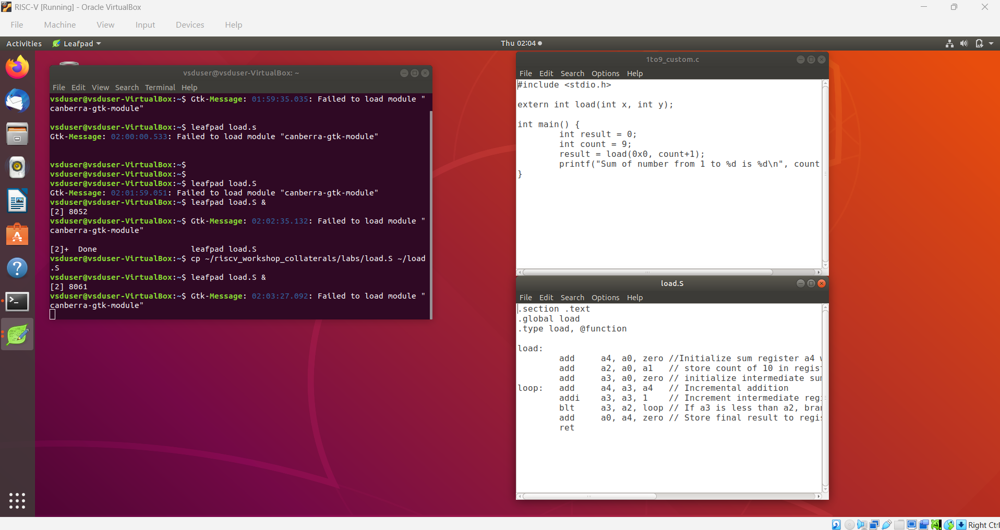
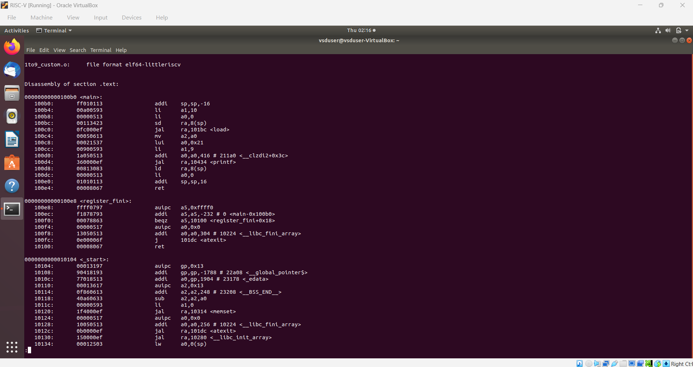
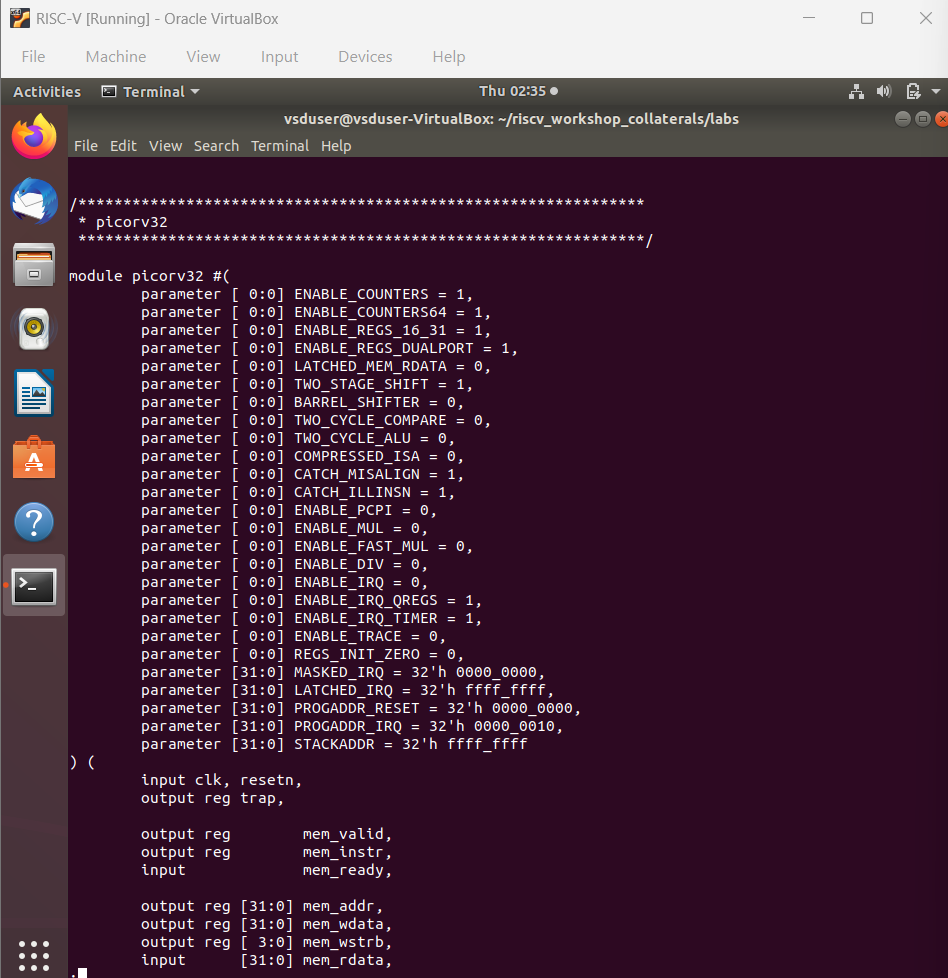
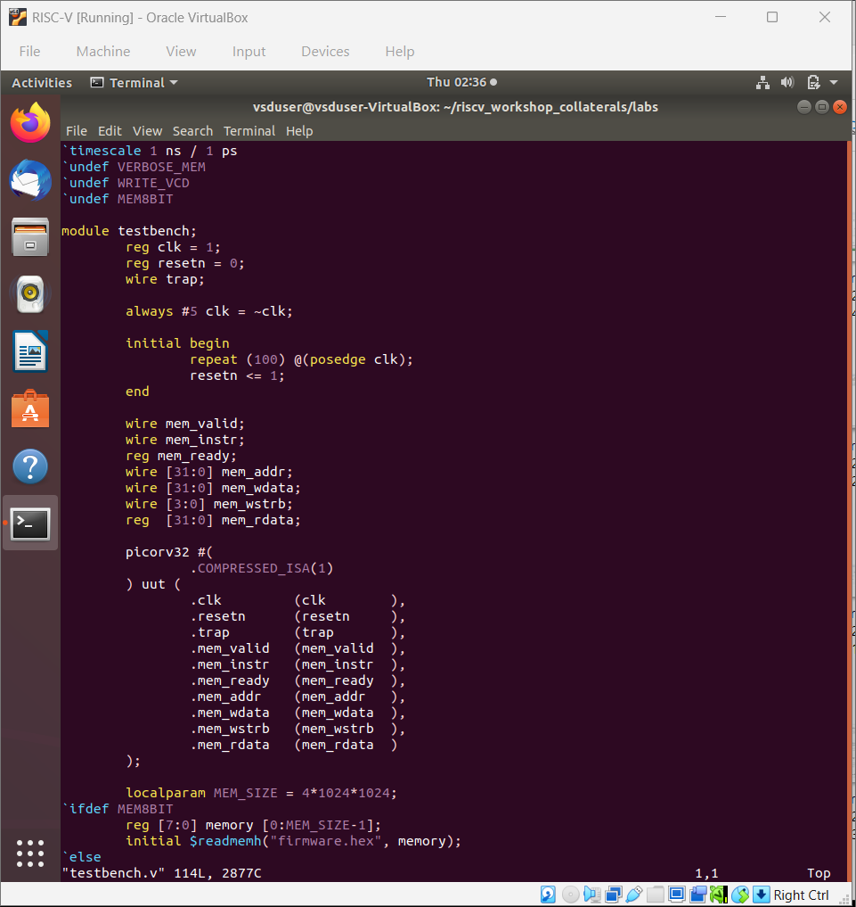
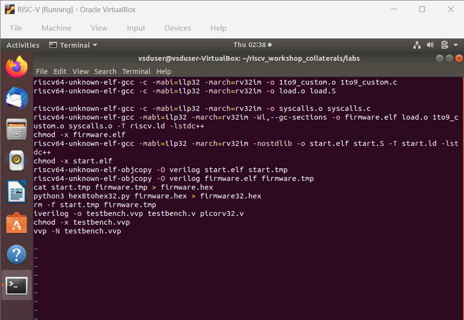
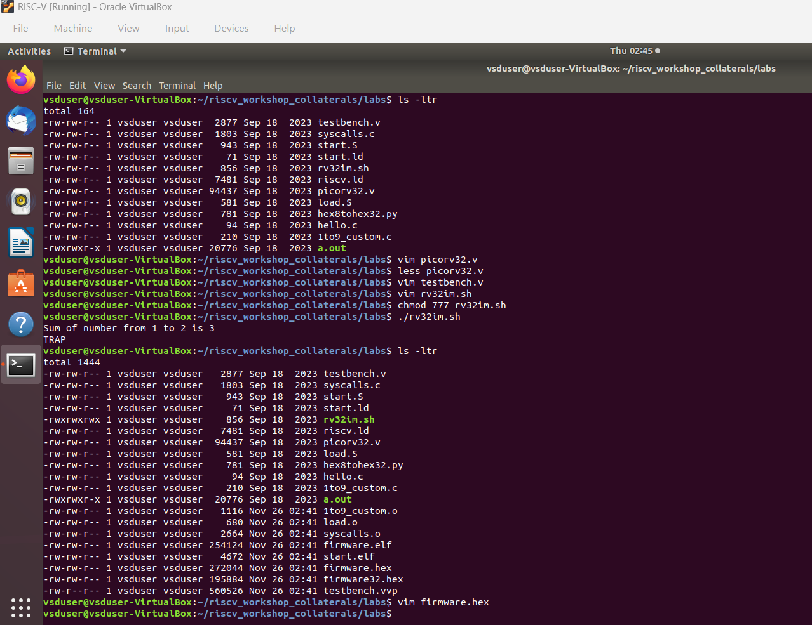

# Day 2 – Base Integer Instructions, ABI & First RISC-V Lab

This day covers the theory of the RISC-V base integer instruction set (RV64I), the Application Binary Interface (ABI), and the first hands-on labs: writing a C program with an assembly routine, compiling it, disassembling it, and running it on the PicoRV32 core in simulation.

---

## Table of Contents
1. [Theory Covered](#theory-covered)
2. [Lab 1 – Sum of Numbers 1 to N (C + Assembly)](#lab-1--sum-of-numbers-1-to-n-c--assembly)
3. [Lab 2 – Disassembly with objdump](#lab-2--disassembly-with-objdump)
4. [Lab 3 – Running the Code Using rv32im.sh (RTL Simulation)](#lab-3--running-the-code-using-rv32imsh-rtl-simulation)

---

## Theory Covered

### 1. Application Binary Interface (ABI)
- An application program (e.g. Excel, written in Java/C++) uses standard libraries (`stdio.h`, `java.text`, `std::array`, ...) through an **Application Programming Interface (API)**.
- Applications reach hardware through the **operating system**. The OS in turn talks to the hardware through the **ISA** (RISC-V, ARM, x86), which is implemented in hardware through **RTL**.
- The **ABI** is the interface between the application and the OS (system call interface). The application accesses hardware resources of the processor through **registers** via system calls.
- Flow: `C program -> compiler -> assembly -> ISA (instructions) -> RTL -> layout`

### 2. Registers and XLEN
- RISC-V has **32 registers** (`x0` – `x31`).
- Each register is **XLEN** bits wide: 32 bits for RV32, 64 bits for RV64.
- Why only 32 registers? The register index is encoded in **5 bits**, so 2^5 = 32 registers.

### 3. Memory and Endianness
- Each memory location holds **1 byte = 8 bits**.
- A 64-bit register can hold 8 bytes (a *doubleword*), so a doubleword occupies 8 consecutive memory locations.
- RISC-V uses **little-endian** addressing: the least significant byte is stored at the lowest address. (Big-endian is the opposite.)

### 4. Load / Store Instructions
| Instruction | Meaning | Type |
|-------------|---------|------|
| `ld x8, 16(x23)` | Load doubleword from address `x23 + 16` into `x8` | I-type |
| `sd x8, 8(x23)`  | Store doubleword from `x8` to address `x23 + 8`  | S-type |
| `add x8, x24, x8`| `x8 = x24 + x8`                                  | R-type |

- `x23` holds the **base address** of the array in memory; the number (e.g. `16`) is the **offset (immediate)**. Final address = base + offset.
- `ld` fields: `immediate[11:0] | rs1 | funct3 | rd | opcode`.
- `sd` fields: the immediate is split into `imm[11:5]` and `imm[4:0]` around `rs2`, `rs1`, `funct3`.
- `opcode` tells the CPU the instruction class; `funct3` / `funct7` give the exact operation.
- All RV64 instructions are **32 bits** wide.

### 5. Instruction Types (Base Integer, RV64I)
- **R-type** – register/register operations (`add`, `sub`, ...)
- **I-type** – immediate and loads (`addi`, `ld`, ...)
- **S-type** – stores (`sd`, ...)
- Base integer instructions operate on signed and unsigned integers.

### 6. ABI Names of Registers

| Register | ABI Name | Usage | Saved by |
|----------|----------|-------|----------|
| x0       | zero     | Hard-wired zero | – |
| x1       | ra       | Return address | Caller |
| x2       | sp       | Stack pointer | Callee |
| x3       | gp       | Global pointer | – |
| x4       | tp       | Thread pointer | – |
| x5–x7    | t0–t2    | Temporaries | Caller |
| x8       | s0 / fp  | Saved register / frame pointer | Callee |
| x9       | s1       | Saved register | Callee |
| x10–x11  | a0–a1    | Function arguments / return values | Caller |
| x12–x17  | a2–a7    | Function arguments | Caller |
| x18–x27  | s2–s11   | Saved registers | Callee |
| x28–x31  | t3–t6    | Temporaries | Caller |

---

## Lab 1 – Sum of Numbers 1 to N (C + Assembly)

**Goal:** Re-write the summation loop in assembly language and call it from a C `main()`.

### Algorithm (flowchart summary)
1. Start with `a0 = 0` (starting value) and `a1 = 10` (count).
2. Initialize `a4` (sum) with zero.
3. Store the count in `a2`.
4. Initialize `a3` (intermediate counter) with zero.
5. Loop: `a4 = a3 + a4`, then `a3 = a3 + 1`.
6. If `a3 < a2`, branch back to the loop; otherwise move the result into `a0` and return.

### `1to9_custom.c`
```c
#include <stdio.h>

extern int load(int x, int y);

int main() {
    int result = 0;
    int count = 9;
    result = load(0x0, count+1);
    printf("Sum of number from 1 to %d is %d\n", count, result);
}
```

### `load.S`
```asm
.section .text
.global load
.type load, @function

load:
        add     a4, a0, zero   // Initialize sum register a4 with 0x0
        add     a2, a0, a1     // store count of 10 in register a2
        add     a3, a0, zero   // initialize intermediate sum register a3 with 0
loop:   add     a4, a3, a4     // Incremental addition
        addi    a3, a3, 1      // Increment intermediate register by 1
        blt     a3, a2, loop   // If a3 is less than a2, branch to label named <loop>
        add     a0, a4, zero   // Store final result to register a0 so that it can be read by main program
        ret
```

### Commands used
```bash
cd ~
leafpad load.S &                                        # open / edit the assembly file
cp ~/riscv_workshop_collaterals/labs/load.S ~/load.S    # copy the lab file to home
leafpad 1to9_custom.c &                                 # open the C file
```

### Screenshot
**Fig 15.1** – `1to9_custom.c` and `load.S` opened in Leafpad.



---

## Lab 2 – Disassembly with objdump

Compile the C file together with the assembly routine and inspect the generated machine code.

```bash
cat 1to9_custom.c
cat load.S
clear
riscv64-unknown-elf-gcc -Ofast -mabi=lp64 -march=rv64i -o 1to9_custom.o 1to9_custom.c load.S
spike pk 1to9_custom.o                                  # run on the Spike ISA simulator
riscv64-unknown-elf-objdump -d 1to9_custom.o | less     # disassemble
```

### What the disassembly shows
- `<main>` starts at `0x100b0` with `addi sp,sp,-16` (allocate stack), loads `a1 = 10`, `a0 = 0`, saves `ra` on the stack (`sd ra,8(sp)`), then calls `load` using `jal`.
- The result in `a0` is moved to `a2` (`mv a2,a0`), `a1 = 9` is loaded, and `printf` is called with `jal`.
- `ld ra,8(sp)` restores the return address, the stack pointer is restored, and `ret` returns.
- Each instruction is 32 bits (e.g. `ff010113` = `addi sp,sp,-16`), matching the instruction formats from the theory section.
- Other routines such as `register_fini`, `_start`, `memset` and `atexit` come from the C runtime startup code.

### Screenshot
**Fig 16.1** – Disassembly of `1to9_custom.o` (`<main>`, `<register_fini>`, `<_start>`).



---

## Lab 3 – Running the Code Using `rv32im.sh` (RTL Simulation)

**How do we run C code on a RISC-V CPU?**

The RISC-V CPU is written in Verilog (`picorv32.v`). A C program is compiled into a **hex file** that is loaded into the memory of the testbench. The CPU fetches and executes the instructions from this memory and the result is displayed on the terminal.

```
C program --> compile --> firmware.hex --> memory (testbench) --> PicoRV32 CPU --> Display result
```

### Setup
```bash
cd
git clone https://github.com/kunalg123/riscv_workshop_collaterals.git
cd riscv_workshop_collaterals
ls -ltr
cd labs
ls -ltr
```

### Files explored
```bash
vim picorv32.v        # the RISC-V core in Verilog   (:q! to quit)
less picorv32.v
vim testbench.v       # testbench that loads firmware.hex into memory
vim rv32im.sh         # only opens the script to view it; it is run later with ./rv32im.sh
```

### 3.1 `picorv32.v` – the CPU core
The module `picorv32` has configurable parameters (`ENABLE_COUNTERS`, `COMPRESSED_ISA`, `ENABLE_MUL`, `ENABLE_DIV`, `ENABLE_IRQ`, `PROGADDR_RESET`, `STACKADDR`, ...) and a simple memory interface: `clk`, `resetn`, `trap`, `mem_valid`, `mem_instr`, `mem_ready`, `mem_addr`, `mem_wdata`, `mem_wstrb`, `mem_rdata`.

**Fig 17.1** – `picorv32.v`



### 3.2 `testbench.v` – the testbench
- Generates the clock (`always #5 clk = ~clk`) and holds `resetn` low for 100 clock cycles before releasing it.
- Instantiates the CPU as `uut` and connects the memory interface signals.
- Declares a memory of `4*1024*1024` and loads `firmware.hex` into it with `$readmemh`.

**Fig 17.2** – `testbench.v`



### 3.3 `rv32im.sh` – build and simulate script
```bash
riscv64-unknown-elf-gcc -c -mabi=ilp32 -march=rv32im -o 1to9_custom.o 1to9_custom.c
riscv64-unknown-elf-gcc -c -mabi=ilp32 -march=rv32im -o load.o load.S
riscv64-unknown-elf-gcc -c -mabi=ilp32 -march=rv32im -o syscalls.o syscalls.c
riscv64-unknown-elf-gcc -mabi=ilp32 -march=rv32im -Wl,--gc-sections -o firmware.elf load.o 1to9_custom.o syscalls.o -T riscv.ld -lstdc++
chmod -x firmware.elf
riscv64-unknown-elf-gcc -mabi=ilp32 -march=rv32im -nostdlib -o start.elf start.S -T start.ld -lstdc++
chmod -x start.elf
riscv64-unknown-elf-objcopy -O verilog start.elf start.tmp
riscv64-unknown-elf-objcopy -O verilog firmware.elf firmware.tmp
cat start.tmp firmware.tmp > firmware.hex
python3 hex8tohex32.py firmware.hex > firmware32.hex
rm -f start.tmp firmware.tmp
iverilog -o testbench.vvp testbench.v picorv32.v
chmod -x testbench.vvp
vvp -N testbench.vvp
```

Steps in the script:
1. Compile the C file, the assembly file and `syscalls.c` for **RV32IM** (`-march=rv32im`, `-mabi=ilp32`).
2. Link them into `firmware.elf` using the linker script `riscv.ld`.
3. Build `start.elf` (startup code) and convert both ELFs to Verilog hex with `objcopy`.
4. Combine them into `firmware.hex` and convert to 32-bit words (`firmware32.hex`).
5. Compile the RTL + testbench with **Icarus Verilog** (`iverilog`) and run it with `vvp`.

**Fig 17.3** – `rv32im.sh`



### 3.4 Running the script
```bash
chmod 777 rv32im.sh
./rv32im.sh
ls -ltr
vim firmware.hex
vim firmware32.hex
```

Output captured:
```
Sum of number from 1 to 2 is 3
TRAP
```
`TRAP` is printed by the testbench when the CPU raises the `trap` signal at the end of execution. After the run, the build artifacts appear in the directory: `1to9_custom.o`, `load.o`, `syscalls.o`, `firmware.elf`, `start.elf`, `firmware.hex`, `firmware32.hex` and `testbench.vvp`.

**Fig 17.4** – Running `./rv32im.sh` and the generated files



---

## Key Takeaways
- The ABI defines how software uses processor registers; RISC-V has 32 registers selected by 5-bit fields.
- RISC-V is little-endian, with `ld`/`sd` for 64-bit memory access and 32-bit fixed-width instructions.
- A C program can call hand-written assembly (`load.S`) using ABI registers `a0–a7` for arguments and return values.
- `objdump` lets us verify the actual machine code generated for each instruction.
- C code can be converted to a hex file, loaded into testbench memory and executed on the PicoRV32 Verilog core using Icarus Verilog.
